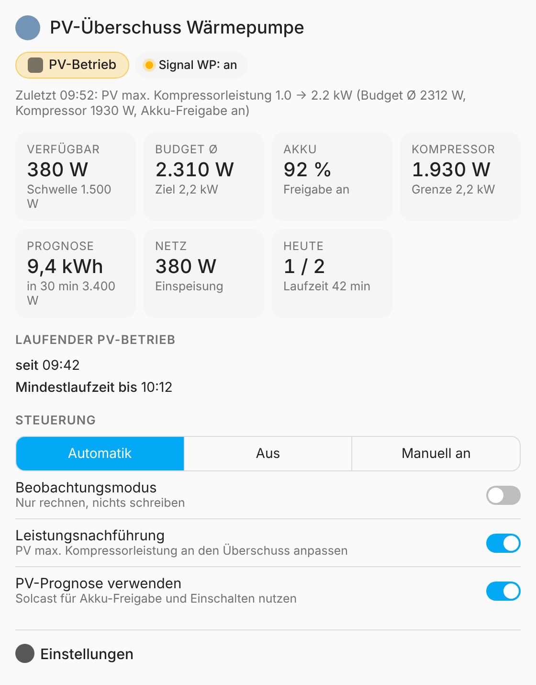

# EMS-ESP WP PV Überschuss

🇬🇧 [English](README.md)

Home-Assistant-Integration, die eine Buderus-, Bosch- oder Junkers-Wärmepumpe über **[EMS-ESP](https://emsesp.org)** bei PV-Überschuss in den PV-/SG-Ready-Betrieb schaltet. Der Batteriespeicher hat Vorrang. Eine PV-Prognose (z. B. Solcast) kann berücksichtigt werden. Optional wird auch die Kompressorleistung an den Überschuss angepasst. Mit dabei ist eine Dashboard-Karte für Status und Einstellungen.

Du brauchst kein YAML, keine Helfer und keine Automationen: installieren, Entitäten auswählen, Karte aufs Dashboard.



## Funktionen

- **PV-Signal über EMS-ESP:** setzt ein Bit in der EMS-ESP-Eingangsoption, z. B. `text.boiler_hpin4opt`: `000000100000` ↔ `100000100000`. Das ist dasselbe Muster wie im evcc-Template für Buderus SG Ready. Nach Neustarts von EMS-ESP oder HA wird der Wert wieder gesetzt.
- **Akku zuerst:** Die Ladeleistung des Akkus zählt erst als Überschuss, wenn der Freigabe-Ladestand erreicht ist oder der Akku laut Prognose heute noch voll wird.
- **Schaltlogik:**
  - Hysterese mit Ein-/Ausschaltschwelle und Verzögerungen
  - Mindestlaufzeit, danach Sperrzeit nach jedem Stopp
  - maximale Aktivierungen pro Tag
  - Startfenster
- **Sofort-Stopp:** bei Akku unter der Abschaltgrenze (2 min), bei Sonnenuntergang oder wenn Messwerte 10 min fehlen.
- **Leistungsnachführung (optional):** passt im PV-Betrieb `PV max. Kompressorleistung` (`pvmaxcomp`) an das gemittelte Budget an (aktuelle Kompressorleistung + verbleibender Überschuss). Die Grenze bleibt in einem Min/Max-Bereich und ändert sich nur alle *n* Minuten, nicht im Sekundentakt.
- **Beobachtungsmodus:** rechnet und schreibt Logbuch-Einträge („würde starten …“), schreibt aber nichts an die Wärmepumpe. **Neue Einrichtungen starten in diesem Modus.**
- **Betriebsarten:** Automatik, Aus (gibt die Wärmepumpe in den Normalbetrieb zurück), Manuell (PV-Betrieb an).
- **Dashboard-Karte:** Status, Live-Werte, Checkliste der Startbedingungen, Betriebsart und alle Einstellungen. Die Integration lädt die Karte selbst, ein Ressourcen-Eintrag ist nicht nötig.
- Deutsch und Englisch. Diagnose-Download für Fehlerberichte.

## Voraussetzungen

- Home Assistant **2025.3** oder neuer
- EMS-ESP, bei dem die Eingangsoptionen der Wärmepumpe als `text`-Entitäten vorhanden sind (z. B. `hpin4opt`). Optional zusätzlich `number.boiler_pvmaxcomp` und `sensor.boiler_hpcurrpower`.
- Sensoren für Netzleistung, Akku-Leistung und Akku-Ladestand (beliebige Wechselrichter-Integration, z. B. GoodWe, Fronius, SMA, Huawei, Victron …)
- Optional: PV-Prognose (z. B. [Solcast](https://github.com/BJReplay/ha-solcast-solar) „verbleibende Prognose heute“ in kWh und „Leistung in 30 Minuten“ in W)
- An der Wärmepumpe muss der Eingang (z. B. Eingang 4) im Regler (HMC300 / HPC410 / Fachmann-Menü) für PV / SG Ready eingestellt sein.

> ⚠️ Lass nicht mehrere Steuerungen gleichzeitig auf dieselbe Eingangs-Entität schreiben (evcc SG Ready, eigene Automationen, Node-RED …), sonst überschreiben sie sich gegenseitig. Zum Vergleich zuerst den Beobachtungsmodus nutzen.

## Installation

### HACS (empfohlen)

1. HACS → ⋮ → **Benutzerdefinierte Repositories** → `https://github.com/WLW186iMuro/emsesp-pv-surplus` mit der Kategorie **Integration** hinzufügen.
2. Nach **EMS-ESP WP PV Überschuss** suchen und installieren.
3. Home Assistant neu starten.

### Manuell

1. `emsesp_pv_surplus.zip` aus dem [neuesten Release](https://github.com/WLW186iMuro/emsesp-pv-surplus/releases/latest) herunterladen.
2. Nach `config/custom_components/emsesp_pv_surplus/` entpacken, z. B. über die Samba-Freigabe oder Studio Code Server.
3. Home Assistant neu starten.

## Einrichtung

**Einstellungen → Geräte & Dienste → Integration hinzufügen → „EMS-ESP WP PV Überschuss“**

| Feld | Beispiel | Hinweis |
|---|---|---|
| EMS-ESP Eingangs-Option | `text.boiler_hpin4opt` | Pflicht |
| Bit-Position | `0` | 0 = erstes Zeichen; bei Buderus/Bosch/Junkers für PV/SG meist 0 |
| Netzleistung | Zähler in W/kW | Vorzeichen wählbar (Bezug positiv / Einspeisung positiv) |
| Akku-Leistung | Akku in W/kW | Vorzeichen wählbar (Entladen positiv / Laden positiv) |
| Akku-Ladestand | SoC in % | Pflicht |
| PV max. Kompressorleistung | `number.boiler_pvmaxcomp` | optional, aktiviert die Nachführung |
| Aktuelle Kompressorleistung | `sensor.boiler_hpcurrpower` | Pflicht bei Nachführung |
| PV-Prognose verbleibend heute | Solcast, kWh | optional |
| PV-Prognose in 30 min | Solcast, W | optional |

Später änderbar über **Integration → Konfigurieren**. Wenn das Verhalten im Beobachtungsmodus passt, schalte auf der Karte den **Beobachtungsmodus** aus.

## Dashboard-Karte

Dashboard bearbeiten → **Karte hinzufügen** → „EMS-ESP WP PV Überschuss“, oder in YAML:

```yaml
type: custom:emsesp-pv-surplus-card
# device_id: …          # nur bei mehreren Einrichtungen
# title: Wärmepumpe PV
# show_settings: true
```

## Einstellungen und Standardwerte

Alle Einstellungen sind Entitäten (number / switch / select / time). Du kannst sie also auch in Automationen oder Skripten verwenden.

| Einstellung | Standard | Bedeutung |
|---|---|---|
| Einschaltschwelle | 1500 W | nötige verfügbare Leistung zum Start |
| Ausschaltschwelle | −800 W | darunter (also 800 W Bezug) läuft die Ausschaltverzögerung |
| Ein-/Ausschaltverzögerung | 5 / 10 min | wie lange die Bedingung anliegen muss |
| Akku-Freigabe ab | 80 % | ab diesem SoC zählt die Ladeleistung als Überschuss |
| Akku-Freigabe mit Prognose ab | 60 % | frühere Freigabe, wenn die Prognose die fehlende Energie + Reserve deckt |
| Akku-Kapazität / Prognose-Reserve | 10 kWh / 4 kWh | für die Prognoseprüfung |
| Akku-Abschaltgrenze | 50 % | darunter Stopp und keine Starts |
| Mindestlaufzeit | 30 min | vorher kein Stopp wegen fehlenden Überschusses |
| Sperrzeit | 120 min | nach jedem Stopp |
| Max. Aktivierungen pro Tag | 2 | |
| Startfenster | 10:00–16:00 | Starts nur in diesem Fenster, Stopps jederzeit |
| Kompressorleistung min./max. | 1,0 / 2,5 kW | Bereich für `pvmaxcomp` |
| Leistungsreserve / Mindeständerung / Intervall | 0,1 kW / 0,2 kW / 5 min | |

Passe die Standardwerte an deine Anlage an: die Akku-Kapazität und den Kompressorbereich für deine Wärmepumpe (die Standardwerte passen zu einem 7-kW-Gerät wie der WLW186i-7).

### Berechnung des Überschusses

```
verfügbar = −Netz − (Akku            wenn Akku freigegeben
                     max(Akku, 0)    sonst)
            (Netz + = Bezug, Akku + = Entladen)

Budget    = Kompressorleistung + verfügbar   (gemittelt über das Intervall)
Ziel      = begrenzt(Budget − Reserve, min, max) bei Akku-Freigabe, sonst min
```

## Entitäten

- **Sensoren:** Status (mit vielen Attributen), verfügbare Leistung, Leistungsbudget, Kompressor-Zielleistung, Aktivierungen heute, PV-Laufzeit heute, Sperrzeit bis
- **Binärsensoren:** PV-Betrieb angefordert, PV-Signal an Wärmepumpe, Akku-Freigabe, Überschuss über Einschaltschwelle
- **Tasten:** Sperrzeit aufheben, Tageszähler zurücksetzen

## Entfernen

Wenn du die Integration löschst, setzt sie das PV-Bit auf Normalbetrieb zurück, falls sie es gesetzt hatte.

## Fehlersuche

- **Karte zeigt „Custom element doesn't exist“:** Seite einmal mit Strg+F5 neu laden. Die Karte ist als Dashboard-Ressource registriert (`/emsesp_pv_surplus/emsesp-pv-surplus-card.js`). Wenn deine Dashboards im YAML-Modus laufen, trage sie selbst als Ressource vom Typ `module` ein.
- **Status „Messwerte fehlen“:** Eine Quell-Entität ist länger als 2 Minuten `unavailable`. Kürzere Aussetzer werden ignoriert.
- **Fehlerberichte:** bitte den Diagnose-Download anhängen (Integration → ⋮ → Diagnosedaten herunterladen).

## Haftungsausschluss

Das ist kein offizielles Projekt von EMS-ESP, Bosch, Buderus oder Junkers. Nutzung auf eigene Gefahr. Prüfe die Eingangskonfiguration deiner Wärmepumpe und die Vorgaben des Herstellers.

## Lizenz

[MIT](LICENSE)
