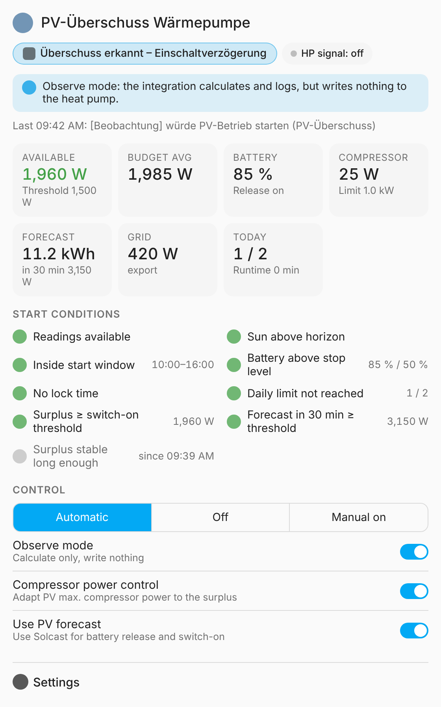

# EMS-ESP PV Surplus

[](https://hacs.xyz/docs/faq/custom_repositories)
[](https://github.com/WLW186iMuro/emsesp-pv-surplus/actions/workflows/validate.yml)

🇩🇪 [Deutsche Anleitung](README.de.md)

A Home Assistant integration that switches a Buderus, Bosch or Junkers heat pump into its PV / SG Ready mode through **[EMS-ESP](https://emsesp.org)** when there is solar surplus. The home battery gets priority, and a PV forecast (for example Solcast) can be taken into account. It can also adjust the compressor power limit to match the surplus. It comes with a dashboard card for status and settings.

No YAML, no helpers, no automations: you install it, pick your entities, and put the card on a dashboard.



## Features

- **PV signal via EMS-ESP:** sets one bit of an EMS-ESP input option, e.g. `text.boiler_hpin4opt`: `000000100000` ↔ `100000100000`. This is the same pattern the evcc template for Buderus SG Ready uses. The value is written again after EMS-ESP or Home Assistant restarts.
- **Battery first:** the battery's charging power only counts as surplus once the battery has reached the release level, or when the forecast says it will still be full today.
- **Switching rules:**
  - hysteresis with on/off thresholds and delays
  - a minimum runtime, then a lock time after each stop
  - a maximum number of activations per day
  - a daily start window
- **Immediate stop:** when the battery falls below the stop level (for 2 min), at sunset, or when readings are missing for 10 min.
- **Compressor power control (optional):** in PV mode it adjusts `PV max. compressor power` (`pvmaxcomp`) to the averaged budget (current compressor power + remaining surplus). The limit stays inside a min/max range and changes only every *n* minutes, never second by second.
- **Observe mode:** it calculates and writes logbook entries ("would start …") but does not write anything to the heat pump. **New installations start in observe mode**, so you can compare it with your current setup first.
- **Modes:** automatic, off (hands the heat pump back to normal operation), manual (PV mode on).
- **Dashboard card:** status, live values, a start-condition checklist, the mode buttons and all settings in one card. The integration loads it automatically, so no resource entry is needed.
- German and English. Diagnostics download for bug reports.

## Requirements

- Home Assistant **2025.3** or newer
- EMS-ESP with the heat pump's input options exposed as `text` entities (e.g. `hpin4opt`). Optionally also `number.boiler_pvmaxcomp` and `sensor.boiler_hpcurrpower`.
- Sensors for grid power, battery power and battery state of charge (any inverter integration, e.g. GoodWe, Fronius, SMA, Huawei, Victron …)
- Optional: a PV forecast (e.g. [Solcast](https://github.com/BJReplay/ha-solcast-solar) "forecast remaining today" in kWh and "power in 30 minutes" in W)
- On the heat pump, the input (e.g. input 4) must be configured for PV / SG Ready on the controller (HMC300 / HPC410 / installer menu).

> ⚠️ Don't run several controllers on the same input entity at the same time (evcc SG Ready, your own automations, Node-RED …), or they will overwrite each other. Use observe mode to compare them first.

## Installation

### HACS (recommended)

1. HACS → ⋮ → **Custom repositories** → add `https://github.com/WLW186iMuro/emsesp-pv-surplus` with the category **Integration**.
2. Search for **EMS-ESP PV Surplus** and install it.
3. Restart Home Assistant.

### Manual

1. Download `emsesp_pv_surplus.zip` from the [latest release](https://github.com/WLW186iMuro/emsesp-pv-surplus/releases/latest).
2. Extract it to `config/custom_components/emsesp_pv_surplus/`, for example through the Samba share or Studio Code Server.
3. Restart Home Assistant.

## Setup

**Settings → Devices & services → Add integration → "EMS-ESP PV Surplus"**

| Field | Example | Notes |
|---|---|---|
| EMS-ESP input option | `text.boiler_hpin4opt` | required |
| Bit position | `0` | 0 = first character; usually 0 for PV/SG on Buderus/Bosch/Junkers |
| Grid power | grid meter in W/kW | sign selectable (import positive / export positive) |
| Battery power | battery power in W/kW | sign selectable (discharge positive / charge positive) |
| Battery state of charge | SoC in % | required |
| PV max. compressor power | `number.boiler_pvmaxcomp` | optional, enables power control |
| Current compressor power | `sensor.boiler_hpcurrpower` | required if power control is used |
| PV forecast remaining today | Solcast, kWh | optional |
| PV forecast power in 30 min | Solcast, W | optional |

Change these later via **Integration → Configure**. When you're happy with the behaviour in observe mode, turn **Observe mode** off on the card.

## Dashboard card

Edit dashboard → **Add card** → "EMS-ESP PV Surplus", or in YAML:

```yaml
type: custom:emsesp-pv-surplus-card
# device_id: …          # only needed with more than one instance
# title: Heat pump PV
# show_settings: true
```

## Settings and defaults

All settings are entities (number / switch / select / time), so you can also use them in automations or scripts.

| Setting | Default | Meaning |
|---|---|---|
| Switch-on threshold | 1500 W | available power needed to start |
| Switch-off threshold | −800 W | below this (i.e. 800 W import) the off delay starts |
| Switch-on / switch-off delay | 5 / 10 min | how long the condition must hold |
| Battery release from | 80 % | from this SoC the charging power counts as surplus |
| Battery release with forecast from | 60 % | earlier release if the forecast covers the missing energy + reserve |
| Battery capacity / forecast reserve | 10 kWh / 4 kWh | for the forecast check |
| Battery stop level | 50 % | stops PV mode and blocks starts below this SoC |
| Minimum runtime | 30 min | no deficit stop before this |
| Lock time | 120 min | after each stop |
| Max. activations per day | 2 | |
| Start window | 10:00–16:00 | starts only in this window; stops are always possible |
| Compressor power min. / max. | 1.0 / 2.5 kW | range for `pvmaxcomp` |
| Power reserve / minimum change / interval | 0.1 kW / 0.2 kW / 5 min | |

Match the defaults to your system: the battery capacity, and the compressor range for your heat pump (the defaults suit a 7 kW unit such as the WLW186i-7).

### How the surplus is calculated

```
available = −grid − (battery            if battery released
                     max(battery, 0)    otherwise)
            (grid + = import, battery + = discharge)

budget    = compressor power + available   (averaged over the interval)
target    = clamp(budget − reserve, min, max) if battery released, otherwise min
```

## Entities

- **Sensors:** status (with lots of attributes), available power, power budget, compressor target, activations today, PV runtime today, locked until
- **Binary sensors:** PV mode requested, PV signal at heat pump, battery release, surplus above threshold
- **Buttons:** lift lock time, reset daily counter

## Removing it

When you delete the integration, it resets the PV bit to normal if it had set it.

## Troubleshooting

- **Card shows "Custom element doesn't exist":** reload the page once with Ctrl+F5. The card is registered as a dashboard resource (`/emsesp_pv_surplus/emsesp-pv-surplus-card.js`). If your dashboards are in YAML mode, add it yourself as a resource of type `module`.
- **Status "Readings missing":** one of the source entities is `unavailable` for more than 2 minutes. Shorter dropouts are ignored.
- **Bug reports:** please attach the diagnostics download (Integration → ⋮ → Download diagnostics).

## Development

```bash
python -m unittest discover -s tests      # logic tests (no HA install needed)
node tests/card_check.mjs <out-dir>       # render the card with Playwright
python tools/gen_translations.py          # regenerate translations
```

## Disclaimer

This is not an official project of EMS-ESP, Bosch, Buderus or Junkers. You use it at your own risk. Check the input configuration of your heat pump and what your manufacturer specifies.

## License

[MIT](LICENSE)
